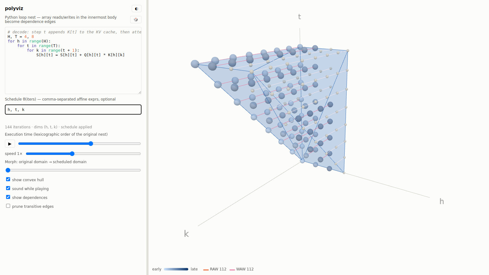
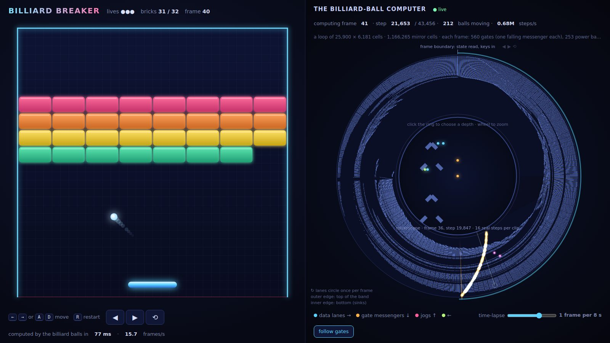

<h1 align="center">Hi, I'm Alex 👋</h1>

  I work on the compiler stack for <a href="https://aws.amazon.com/ai/machine-learning/trainium/">AWS Trainium</a>,
  turning Python kernels into code that runs well on custom silicon.

---

### What I do

- 🧩 Build the [NKI](https://awsdocs-neuron.readthedocs-hosted.com/en/latest/nki/index.html) compiler: Python → MLIR → hardware
- ✍️ Write about compilers, hardware, and whatever else I am learning on [Substack](https://substack.com/@alexjhuang)
- 🎾 Off the clock: tennis, climbing, and guitar

### Around here

- [`personal-site`](https://github.com/alexjhuang/personal-site) — my corner of the web
- [`polyviz`](https://github.com/alexjhuang/polyviz) — live polyhedral visualizer for Python loop nests ([try it](https://alexjhuang.github.io/polyviz/))
- [`billiard-breaker`](https://github.com/alexjhuang/billiard-breaker) — Breakout whose game logic runs on a billiard-ball cellular automaton ([play it](https://alexjhuang.github.io/billiard-breaker/))

<table>
  <tr>
    <td width="50%"></td>
    <td width="50%"></td>
  </tr>
  <tr>
    <td align="center">polyviz: causal KV-cache attention as a polyhedron</td>
    <td align="center">billiard-breaker: every frame computed by bouncing balls</td>
  </tr>
</table>

### Say hello

Open an issue, start a discussion, or find me on [LinkedIn](https://www.linkedin.com/in/alexjhuang).

Thanks for stopping by.

